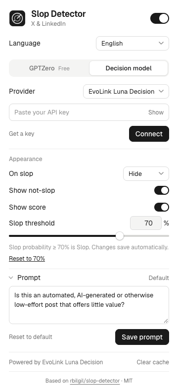

<div align="center">

# Slop Detector · EvoLink

Filter low-quality AI content on X and LinkedIn with EvoLink Luna Decision.

[English](README.md) · [简体中文](README.zh-CN.md) · [Get an EvoLink key](https://evolink.ai/dashboard/keys?utm_source=github&utm_medium=extension&utm_campaign=slop)

[](LICENSE)

</div>

A Chrome extension that checks visible posts, comments and replies, then stamps, fades or hides content that meets your Slop threshold. This adaptation adds EvoLink as the default provider and an English / Simplified Chinese interface to [Robin Bilgil's Slop Detector](https://github.com/rbilgil/slop-detector).

## Features

- **EvoLink Luna Decision by default**, with OpenRouter and direct Jev (TypeSafe) as alternatives. AI Gateway has been removed.
- **English / 简体中文**, switchable in settings or selected from the browser language.
- **Custom threshold from 0% to 100%**, in 1% increments, with a slider, number input and reset button.
- **Slop probability ≥ 70% means Slop by default.** A Not slop label displays the complementary probability, not a second independent score.
- Stamp, fade or hide flagged content; pause scanning at any time.
- GPTZero remains an optional detector. Personal keys work directly; free scanning requires your own configured proxy.

Scores are model judgments, not proof that a person used AI. Only text is checked; images and videos are not analyzed.

## Install

Requires Chrome 120+ and Node **24.18+ within 24.x**, with npm. This repository provides a source install; it is not a Chrome Web Store listing.

```sh
git clone https://github.com/cheercheung/slop-detector.git
cd slop-detector
npm ci
npm run build
```

1. Open `chrome://extensions` in Chrome.
2. Enable **Developer mode**.
3. Choose **Load unpacked** and select the generated **`dist`** folder inside this repository.
4. Pin **Slop Detector** using Chrome's extensions menu, then open its popup.

You do not need a `.env` file. Enter your personal API key in the extension popup.

## Connect and use

1. Select **Decision model → EvoLink Luna Decision**. This is the default on a fresh install.
2. Click **Get a key** to open the [EvoLink key dashboard](https://evolink.ai/dashboard/keys?utm_source=github&utm_medium=extension&utm_campaign=slop).
3. Paste your key in **API key**, click **Connect**, and grant the requested provider access. Connect sends one sample request and may incur a charge.
4. For a first test, select **On slop → Fade out** or **Stamp**, and enable **Show score**.
5. Refresh X or LinkedIn. Visible text posts, comments and replies will be checked.
6. Turn off the top switch to pause scanning when you finish.

<p align="center"></p>

### Threshold and language

- **Slop threshold:** enter a whole number from **0 to 100**, then press Tab or click outside the field. Slider changes save when released. **Reset to 70%** restores the default.
- A score of **70% is Slop** at a 70% threshold; 69.9% is not. Raising the threshold flags fewer posts. At 0%, every valid Luna score qualifies; at 100%, only a score of 100% qualifies.
- Changing the threshold updates existing labels using cached scores; it does not request another model evaluation for those scores.
- **Language:** select **Browser language**, **English**, or **简体中文**. The setting is saved and applies to popup controls and feed labels. Your prompt text is preserved.
- Existing saved OpenRouter/Jev settings remain selected after an update. A retired AI Gateway selection resets to EvoLink; its key is not reused with another provider.

## Providers

| Provider | Model | Key |
| --- | --- | --- |
| **EvoLink Luna Decision (default)** | `gpt-6-luna-decisions` | [EvoLink dashboard](https://evolink.ai/dashboard/keys?utm_source=github&utm_medium=extension&utm_campaign=slop) |
| OpenRouter | `typesafe/jev-1.13` | [OpenRouter keys](https://openrouter.ai/settings/keys) |
| Jev (TypeSafe) | `jev-latest` | [TypeSafe console](https://console.typesafe.ai/) |

EvoLink uses `POST https://direct.evolink.ai/v1/decisions` and reads the returned predicate probability. This extension does not use a text-generation model to invent a score. Each provider requires its own key; there is no automatic provider fallback.

GPTZero is available in its separate tab. Choose **Your API key** for direct access. The repository does not ship an operating free-scan proxy; self-hosting instructions are in [CLOUDFLARE_SETUP.md](CLOUDFLARE_SETUP.md).

## Privacy

Visible post text (up to 6,000 characters per item) is sent to your chosen provider, along with your custom prompt for decision models. Connecting a key sends a synthetic sample. Keys stay in local extension storage, are not synced, and are not an encrypted vault. Do not commit keys to this repository.

The extension caches text fingerprints and scores. You can pause scanning, clear the cache or remove the saved key from the popup. See [PRIVACY.md](PRIVACY.md).

## Update and troubleshoot

After pulling an update, run `npm ci` and `npm run build`, click **Reload** on the extension at `chrome://extensions`, then refresh the feed.

- **No labels:** check the top switch, site access, connection status and **Show not-slop**.
- **No free GPTZero:** use a personal GPTZero key or configure your own proxy.
- **Connection fails:** check the selected provider, key, credits and requested permissions.
- **Want to recheck text:** choose **Clear cache**. New evaluations may incur charges.

## Development

```sh
npm run check
npx playwright install chromium
npm run test:browser
npm run test:customization
npm run test:proxy
npm run test:gptzero
npm run package
```

`npm run check` runs lint, TypeScript checks, mocked tests, the extension build, package validation and repository hygiene checks. Browser tests use isolated profiles and synthetic data. `npm run package` creates `slop-detector.zip`; unzip it and load the extracted folder in Chrome.

See [CONTRIBUTING.md](CONTRIBUTING.md) and [adaptation notes](docs/ADAPTATION.md). Mock checks do not measure live model quality, latency or billing.

## Source and license

Based on **[rbilgil/slop-detector](https://github.com/rbilgil/slop-detector)** by **[Robin Bilgil](https://github.com/rbilgil)**, adapted from commit `365e11972afea2907d2edac3d2509e857dfe3fff` (v2.1.3). This is an independently maintained adaptation; upstream authorship is preserved. The extension footer also links to the original repository.

[MIT](LICENSE), retaining the original copyright notice. The bundled Geist font remains under the [SIL Open Font License](public/fonts/OFL.txt).
