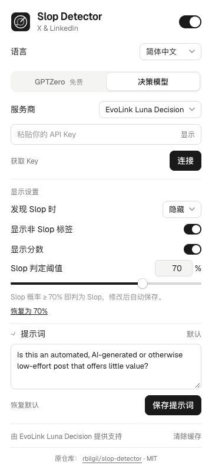

<div align="center">

# Slop Detector · EvoLink

使用 EvoLink Luna Decision，筛选 X 和 LinkedIn 中的低质量 AI 内容。

[English](README.md) · [简体中文](README.zh-CN.md) · [获取 EvoLink Key](https://evolink.ai/dashboard/keys?utm_source=github&utm_medium=extension&utm_campaign=slop)

[](LICENSE)

</div>

一个 Chrome 扩展：检测当前可见的帖子、评论和回复，按照你设置的 Slop 阈值，对内容盖章、淡化或隐藏。本版本基于 [Robin Bilgil 的 Slop Detector](https://github.com/rbilgil/slop-detector)，新增 EvoLink 默认服务商和中英文界面。

## 功能

- 默认使用 **EvoLink Luna Decision**，可切换 **OpenRouter** 或 **Jev（TypeSafe）**。已移除 AI Gateway。
- 支持 **English / 简体中文**，可手动切换或跟随浏览器语言。
- 阈值可自定义为 **0%–100%**，每次调整 1%，支持滑块、数字输入和恢复默认。
- 默认 **Slop 概率 ≥ 70% 就判为 Slop**。非 Slop 标签显示的是互补概率，不是另一个独立评分。
- 对命中内容盖章、淡化或隐藏，随时可暂停检测。
- 保留 GPTZero 检测器：个人 Key 可直接使用；免费模式需要自行配置代理。

分数只是模型判断，不能证明作者使用了 AI。扩展只分析文字，不分析图片和视频。

## 安装

需要 Chrome 120+、**Node 24.18+（限 24.x）** 和 npm。本仓库提供源码安装，并非 Chrome 应用商店版本。

```sh
git clone https://github.com/cheercheung/slop-detector.git
cd slop-detector
npm ci
npm run build
```

1. 在 Chrome 地址栏输入 `chrome://extensions`。
2. 开启右上角的「开发者模式」。
3. 点击「加载已解压的扩展程序」，选择本仓库内生成的 **`dist` 文件夹**。
4. 在 Chrome 的扩展菜单中固定 **Slop Detector**，然后打开扩展弹窗。

不需要 `.env` 文件。API Key 直接填写在扩展弹窗中。

## 连接和使用

1. 选择「**决策模型 → EvoLink Luna Decision**」。首次安装默认已选中。
2. 点击「获取 Key」，打开 [EvoLink Key 控制台](https://evolink.ai/dashboard/keys?utm_source=github&utm_medium=extension&utm_campaign=slop)。
3. 在「API Key」中粘贴你的 Key，点击「连接」，允许 Chrome 请求的服务商访问权限。连接会发送一条样例请求，可能产生费用。
4. 首次测试可把「发现 Slop 时」设为「**淡化**」或「**盖章**」，并开启「显示分数」。
5. 刷新 X 或 LinkedIn，即可检测当前可见的文字帖子、评论和回复。
6. 测试结束后，关闭顶部开关即可暂停检测。

<p align="center"></p>

### 阈值与语言

- **Slop 判定阈值**：输入 **0–100** 的整数，按 Tab 或点击输入框以外的位置自动保存。滑块松开后保存。「恢复为 70%」可还原默认值。
- 阈值为 70% 时，**70% 判为 Slop，69.9% 不判为 Slop**。阈值越高，命中的内容越少。设为 0% 时所有有效 Luna 分数都会命中；设为 100% 时仅 100% 的分数命中。
- 调整阈值会复用已有的缓存分数，直接更新标签，不会为这些分数再次调用模型。
- **语言**：可选择「跟随浏览器」「English」或「简体中文」。设置会保存，并同步到弹窗和信息流标签。你的提示词原文会保留。
- 更新时保留已有的 OpenRouter / Jev 设置。原来选用 AI Gateway 的设置会回到 EvoLink，其 Key 不会被用于其他服务商。

## 服务商

| 服务商 | 模型 | 获取 Key |
| --- | --- | --- |
| **EvoLink Luna Decision（默认）** | `gpt-6-luna-decisions` | [EvoLink 控制台](https://evolink.ai/dashboard/keys?utm_source=github&utm_medium=extension&utm_campaign=slop) |
| OpenRouter | `typesafe/jev-1.13` | [OpenRouter Keys](https://openrouter.ai/settings/keys) |
| Jev（TypeSafe） | `jev-latest` | [TypeSafe 控制台](https://console.typesafe.ai/) |

EvoLink 使用 `POST https://direct.evolink.ai/v1/decisions`，读取接口返回的 predicate 概率，不通过文字生成模型编造分数。各服务商需要各自的 Key，不会自动切换到其他服务商。

GPTZero 位于单独的标签页。选择「自有 API Key」可直接调用。本仓库未附带可用的免费检测代理；自行部署方法见 [CLOUDFLARE_SETUP.md](CLOUDFLARE_SETUP.md)。

## 隐私

扩展会把可见帖子文字（每条最多 6,000 字符）发送给你选择的服务商；决策模型还会收到自定义提示词。连接 Key 时会发送一条合成样例。Key 保存在本机扩展存储，不会同步，但该存储不是加密保险库。请勿把 Key 提交到仓库。

扩展缓存的是文字指纹和分数。你可以在弹窗中暂停检测、清除缓存或移除已保存的 Key。完整说明见 [PRIVACY.md](PRIVACY.md)。

## 更新与排错

拉取更新后，执行 `npm ci` 和 `npm run build`，在 `chrome://extensions` 点击扩展的「重新加载」，再刷新信息流。

- **没有标签**：检查顶部开关、网站访问权限、连接状态和「显示非 Slop 标签」。
- **GPTZero 免费模式不可用**：使用个人 GPTZero Key，或自行配置代理。
- **连接失败**：检查服务商选择、Key、额度及 Chrome 请求的权限。
- **想重新检测**：点击「清除缓存」。新的检测请求可能产生费用。

## 开发

```sh
npm run check
npx playwright install chromium
npm run test:browser
npm run test:customization
npm run test:proxy
npm run test:gptzero
npm run package
```

`npm run check` 包含 lint、TypeScript 检查、模拟测试、扩展构建、打包内容验证和仓库检查。浏览器测试使用独立 profile 和合成数据。`npm run package` 生成 `slop-detector.zip`，解压后可直接在 Chrome 中加载。

参见 [CONTRIBUTING.md](CONTRIBUTING.md) 和 [改编记录](docs/ADAPTATION.md)。模拟检查不代表真实模型效果、速度或计费已验证。

## 来源与许可证

本项目基于 **[rbilgil/slop-detector](https://github.com/rbilgil/slop-detector)**，原作者为 **[Robin Bilgil](https://github.com/rbilgil)**；改编起点为提交 `365e11972afea2907d2edac3d2509e857dfe3fff`（v2.1.3）。这是独立维护的改编版本，保留原作者署名。扩展页脚也提供原仓库链接。

采用 [MIT 许可证](LICENSE)，保留原始版权声明。内置 Geist 字体继续遵守 [SIL Open Font License](public/fonts/OFL.txt)。
